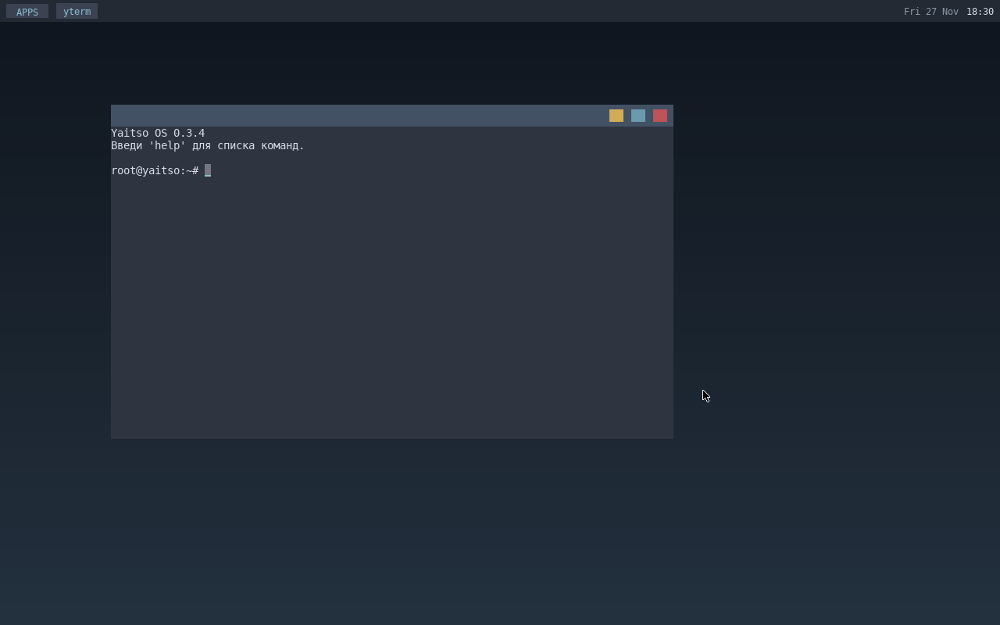

# Yaitso OS 0.3.4

**Lightweight independent Linux distribution with a custom Wayland compositor, shell, and package manager.**

**Русская версия:** [README_RU.md](README_RU.md)



## Download and quick start

The latest ISO image is attached to the
[Yaitso_0.3.4 release](https://github.com/YAITSO-dev/YAITSO_OS/releases/download/Yaitso_0.3.4/yaitso-0.3.4.iso).

Boot it in QEMU without installing:

```sh
qemu-system-x86_64 -m 2048 -smp 2 -cdrom yaitso-0.3.4.iso -boot d -vga std
```

If `/dev/kvm` is available, add `-enable-kvm -cpu host` for near-native speed.
On a Linux host you can also use the helper script:

```sh
./run-qemu.sh yaitso-0.3.4.iso          # BIOS
./run-qemu.sh yaitso-0.3.4.iso uefi     # UEFI
```

The live image starts the graphical session automatically: `ycomp` brings up
the compositor, `ybar` appears at the top of the screen, and `yterm` opens a
shell. To install, choose **Yaitso OS 0.3.4 (install)** in the GRUB menu or run
`yaitso-install`; the installer formats the target disk and sets up the
bootloader, user account, and graphical session.

## Architecture

Yaitso OS is an independent, source-built Linux distribution for x86_64.
It does not use systemd or a conventional desktop environment: core
userland utilities are provided by `ybox` instead of BusyBox, packages are
managed by `yat`, and the desktop is built on a custom Wayland stack. The
system is assembled from small components with a single responsibility:

| Layer | Components |
|---|---|
| Kernel | Linux kernel (x86_64) with DRM/KMS and evdev input |
| Init and services | `init` (PID 1), `svc`, `getty`, `login` |
| Shell and userland | `yaitso` shell, `ybox` multi-call utilities |
| Packages | `yat` package manager, signed `.yat` repositories |
| Graphics | `ycomp` compositor, `libywt`, `ybar`, `yterm`, `ylaunch` |
| Compatibility | glibc 2.40 in `/usr/glibc` through `yglibc` |

### ycomp

A Wayland compositor built on wlroots 0.18 and DRM/KMS. It implements
`xdg-shell`, layer-shell, seat/keyboard/pointer handling, client window
management, keyboard focus, hotkeys, and a private IPC socket in `$XDG_RUNTIME_DIR`
(`/run/ycomp.sock` for root). Windows have server-side title bars with minimize,
maximize/restore, snap-to-half, close buttons, and drag/resize support.
In minimal images without udev or libinput data it reads `/dev/input/event*`
directly and falls back to a built-in US keymap when no xkb data is installed.

### ybar

The top panel. It is an ordinary Wayland client (`app_id=ybar.yaitso`) that
uses `libywt` for rendering. It has a clickable APPS button, a clickable
window list that highlights the focused window and dims minimized ones, and
shows the date, clock, battery, and network address through the compositor IPC.

### yterm

A terminal emulator with its own PTY and VT100/ECMA-48 parser. It supports
UTF-8, CSI sequences across read boundaries, tabs (`Ctrl+Shift+T/W`,
`Alt+1..9`), buffer search, bracketed paste, bell notification, and scrollback.

### libywt

A small Wayland toolkit shared by the GUI programs. It wraps `wl_display`,
`wl_shm`, `xdg_shell`, `wl_seat`, xkbcommon, FreeType font rendering, and
surface drawing. This keeps `ybar`, `yterm`, and `ylaunch` small and free of
a large desktop toolkit dependency.

### yat

The package manager. It installs, removes, verifies, and upgrades `.yat`
packages from signed repositories, resolves dependencies, supports HTTPS
repositories, and provides `why`, `graph`, `pin`, `rollback`, and `verify`
commands.

### yaitso

The default interactive shell. It provides pipelines, redirections
(`2>&1`, `&>`, `>>`, and others), background jobs, command history,
tab completion, suggestions, UTF-8 aware editing, positional parameters,
and a set of built-in commands.

### ybox

A multi-call binary that provides the core userland utilities without
BusyBox: file operations (including recursive `cp` and `chown`), text tools,
process and system inspection, and other commands used by the boot process,
installer, and shell.

### Supporting components

`init` mounts the virtual filesystems, loads GPU and input modules, and starts
gettys; `login` starts the graphical session after authentication. `svc`
manages services, `ywifi` handles wireless networks, `yhttpd` serves package
repositories, `ytui` provides a text UI, `ylaunch` starts `.desktop`
applications, `yaitso-install` installs the system to disk, and
`yaitso-control` exposes system controls. The optional glibc layer lets
prebuilt third-party software (such as Firefox ESR) run on top of the
distribution's own libc.

## Building from source

### System requirements

- x86_64 Linux host
- GCC, GNU Make, pkg-config
- Rust toolchain (Cargo) for the `yat` package manager
- network on the first build, or run `make -C yat vendor` once to fetch
  the crates; after that `yat` builds offline with `--frozen`
- Wayland, wayland-protocols, libdrm, libinput, libxkbcommon
- pixman, wlroots >= 0.18, FreeType 2, OpenSSL
- Meson and Ninja for wlroots/glibc components
- QEMU for testing the ISO (optional)
- root privileges for creating the image (`make iso-gui`; `sudo` is requested for the image steps only)

The resulting system runs with 2 GB of RAM; the live ISO uses the `bochs`
DRM driver under QEMU's `-vga std`, or `virtio_gpu` with `-vga virtio`.

### Build commands

```sh
make                    # shell, init, installer, yat, ybox and utilities
make gui                # ycomp, libywt, ybar, yterm, ylaunch, start-desktop
make test               # smoke and shell tests
make check              # build everything and run tests

make repo repo-sign     # build and sign packages
make iso-gui            # create yaitso-0.3.4.iso (sudo only for image steps)
make qemu-gui           # boot the ISO in QEMU (VNC on :1)
```

Compiled executables, object files, and the `gui-out` staging tree are not
stored in the repository; `make` and `make gui` regenerate them.

### Installing to disk

Boot the ISO, choose **Yaitso OS 0.3.4 (install)** in GRUB, and follow the
prompts. The installer can also be driven non-interactively:

```sh
yaitso-install --disk /dev/vda --hostname yaitso --user andrey \
    --password secret --gui --yes
```

It creates a GPT layout (ESP + root on UEFI, BIOS boot + root otherwise),
formats the filesystems, copies the live system, writes `/etc/fstab` with
UUIDs, creates the user, locks the root password, and installs GRUB for the
selected firmware. Add `--luks` (and `--luks-password`) to encrypt the root
filesystem with LUKS2; the installer then creates a separate unencrypted
`/boot` partition so GRUB can load the kernel and initramfs.

### Known limitations

- glibc compatibility layer: x86_64 only, accounts are file-based
  (`passwd`/`group`/`shadow`)
- GUI: Wayland only, no XWayland
- VT100: no Sixel or mouse reporting
- The graphical session requires a DRM/KMS device

## Changelog 0.3.4

Yaitso OS 0.3.4 fixes pointer input in the live session and adds optional
LUKS2 disk encryption to the installer.

### Input

- `ycomp` deduplicates evdev nodes by physical device path, so a mouse that
  exposes both absolute and relative event nodes no longer makes the cursor
  jump between positions
- touchpads are no longer mapped onto the whole screen: absolute finger
  coordinates are converted to relative motion
- `SYN_DROPPED` is handled, and pointer focus uses `enter` only when the
  surface under the cursor actually changes

### Installer and boot

- New options `--luks`, `--no-luks`, and `--luks-password`, plus an
  interactive question in the default flow
- LUKS2 root (`aes-xts-plain64`, 512-bit key) with a separate unencrypted
  1 GiB `/boot` partition, because GRUB cannot read a kernel from LUKS
- The installed initramfs ships `cryptsetup` and dm-crypt modules, prompts
  for the passphrase, unlocks the root, mounts `/boot`, and runs `switch_root`
- The fallback UEFI loader finds both `/grub/grub.cfg` and
  `/boot/grub/grub.cfg`
- The non-LUKS partition layout is unchanged

### Other

- Version bumped to 0.3.4 in packages, man pages, and documentation

## Changelog 0.3.31

Yaitso OS 0.3.31 replaces the C `yat` with a Rust implementation and hardens
package installation. The desktop is unchanged from 0.3.3.

### yat

- Rewritten in Rust (`ed25519-dalek`), including `yat-keygen` and `yat-sign`
- Safe archive extraction, symlink/hardlink handling, dependency cycle
  protection, and validation of package names and versions
- Numeric version comparison, `PIN` support, and `upgrade` that only installs
  genuinely newer versions and removes obsolete files
- Signed package/index verification, atomic `yat update`, and rollback that
  restores files, symlinks, and package metadata
- Preserved `search`, `why`, `graph`, `pin`, `rollback`, and `verify`
- Cargo build integration, offline vendoring, and 9 regression tests

## Changelog 0.3.3

Yaitso OS 0.3.3 focuses on a usable desktop, a real installer, and a correct
login/session architecture. The full history is in [CHANGELOG.md](CHANGELOG.md).

### Desktop

- Server-side title bars with close, maximize/restore, and minimize
- Drag windows by the title bar; resize from edges and corners
- Maximize, restore, snap to the left/right half, and minimize/restore
- `Super+Return` terminal, `Super+D` launcher, `Super+Q` close,
  `Super+M` maximize, `Super+←/→` snap, `Super+H` minimize,
  `Super+Tab`/`Alt+Tab` switch
- Clickable `ybar` window list, minimized-window styling, date, clock
- `ylaunch` supports mouse, scrolling, and paging, and is centered by `ycomp`
- Gradient desktop background with configurable colors
- New IPC commands: `maximize`, `restore`, `toggle`, `minimize`,
  `unminimize`, `snap`, `next`, `prev`

### Installer

- Rewritten `yaitso-install`: GPT partitioning for UEFI and BIOS with
  `parted`/`sfdisk`, `mkfs.ext4`/`mkfs.vfat`, and UUID-based `/etc/fstab`
- System copy implemented in C, without external `cp`/`rsync`
- User creation, SHA-512 password hash, root account locked
- GRUB installation for UEFI and BIOS, with a fallback `BOOTX64.EFI`
- A minimal installed-system initramfs (BusyBox + storage drivers) whose
  `/init` mounts the root partition and runs `switch_root`
- GRUB entry **Yaitso OS 0.3.3 (install)** using `yaitso.install=1`
- Options: `--list`, `--disk`, `--hostname`, `--user`, `--password`,
  `--gui`/`--no-gui`, `--efi`/`--bios`, `--yes`, `--force`
- Static build; the live image ships `parted`, `e2fsprogs`, `dosfstools`,
  `grub`, and their libraries

### Session and system

- `init` always starts `getty`/`login`; `login` starts `start-desktop` after
  authentication, and logout returns to the login prompt
- Live autologin via `/etc/yaitso/autologin`; the installed system removes it
- `start-desktop` prepares `XDG_RUNTIME_DIR`, Wayland variables, and waits for
  the compositor socket
- BusyBox applet symlinks in the live image (`cp`, `tar`, `find`, `grep`,
  `df`, `free`, `touch`, `mktemp`, `realpath`, and more)
- Kernel and initramfs are present inside the live system so the installer can
  install them

### Fixes

- Window jitter and drift while dragging or resizing
- The panel no longer steals keyboard focus
- The panel and launcher now receive their initial configure, and `libywt`
  never attaches a buffer before configure, fixing
  `xdg_surface has never been configured`
- Windows stay inside the usable area and keep their title bar reachable
- IPC `list` handles windows without titles
- IPC socket lives in `$XDG_RUNTIME_DIR`, so the panel works for regular
  users, not only for root

## Changelog 0.3.2

Yaitso OS 0.3.2 was a security, stability, and correctness release.

- `login`, `passwd`, `su`, and `sudo` verify passwords against `/etc/shadow`
  with `getspnam` + `crypt`; empty and locked hashes are rejected
- `passwd` checks the old password and writes `shadow` atomically
- `sudo` drops supplementary groups; `useradd`/`userdel` update accounts
  atomically and remove home directories without `system()`
- Correct redirection parsing (`2>&1`, `&>`, and others), background jobs,
  built-ins in pipelines, positional parameters, and `printf` escapes
- `ycomp` creates the missing globals, sends the first configure, performs an
  atomic DRM mode set, and falls back to direct evdev input
- `libywt` registers the `wl_seat` listener before `capabilities`
- `yterm` handles UTF-8 and CSI sequences across read boundaries
- `ybox` gained native recursive `cp` and `chown`; `yat upgrade` compares
  versions and installs only newer packages

### License

- The project moved from CC BY-NC-SA 4.0 to GNU GPL v2 (see `LICENSE`)

## Roadmap

- **0.4.0** — LUKS, native SSH, heredoc, `$()`, `if`/`for`/`while`
- **0.5.0** — `sed`/`awk`, native `tar`/`gzip`, ycomp workspaces
- **0.6.0** — no BusyBox dependency, `ysnap` snapshots
- **0.7.0** — XWayland, PipeWire audio

## License

This project is distributed under the
[GNU General Public License version 2 (GPLv2)](https://www.gnu.org/licenses/old-licenses/gpl-2.0.html).
See [LICENSE](LICENSE) for the full text.
