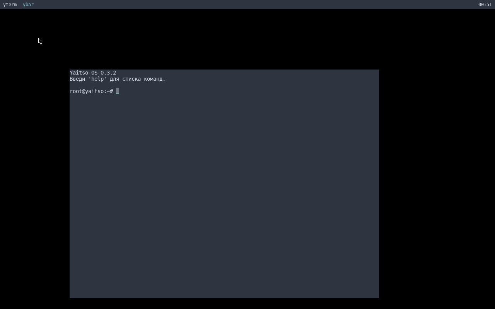

# Yaitso OS 0.3.2

**Lightweight independent Linux distribution with a custom Wayland compositor, shell, and package manager.**

**Русская версия:** [README_RU.md](README_RU.md)



## Download and quick start

The latest ISO image is attached to the
[Yaitso_0.3.2 release](https://github.com/YAITSO-dev/YAITSO_OS/releases/download/Yaitso_0.3.2/yaitso-0.3.2.iso).

Boot it in QEMU without installing:

```sh
qemu-system-x86_64 -m 2048 -smp 2 -cdrom yaitso-0.3.2.iso -boot d -vga std
```

If `/dev/kvm` is available, add `-enable-kvm -cpu host` for near-native speed.
On a Linux host you can also use the helper script:

```sh
./run-qemu.sh yaitso-0.3.2.iso          # BIOS
./run-qemu.sh yaitso-0.3.2.iso uefi     # UEFI
```

The live image starts the graphical session automatically: `ycomp` brings up
the compositor, `ybar` appears at the top of the screen, and `yterm` opens a
root shell.

## Architecture

Yaitso OS is an independent, source-built Linux distribution for x86_64.
It does not use systemd or a conventional desktop environment: core
userland utilities are provided by `ybox` instead of BusyBox, packages are
managed by `yat`, and the desktop is built on a custom Wayland stack. The
system is assembled from small components with a single responsibility:

| Layer | Components |
|---|---|
| Kernel | Linux kernel (x86_64) with DRM/KMS and evdev input |
| Init and services | `init` (PID 1), `svc`, `getty`, `login` |
| Shell and userland | `yaitso` shell, `ybox` multi-call utilities |
| Packages | `yat` package manager, signed `.yat` repositories |
| Graphics | `ycomp` compositor, `libywt`, `ybar`, `yterm`, `ylaunch` |
| Compatibility | glibc 2.40 in `/usr/glibc` through `yglibc` |

### ycomp

A Wayland compositor built on wlroots 0.18 and DRM/KMS. It implements
`xdg-shell`, layer-shell, seat/keyboard/pointer handling, client window
management, keyboard focus, hotkeys, and a private IPC socket at
`/run/ycomp.sock`. In minimal images without udev or libinput data it reads
`/dev/input/event*` directly and falls back to a built-in US keymap when no
xkb data is installed.

### ybar

The top panel. It is an ordinary Wayland client (`app_id=ybar.yaitso`) that
uses `libywt` for rendering, lists open windows, highlights the focused one
through the compositor IPC, and shows the clock.

### yterm

A terminal emulator with its own PTY and VT100/ECMA-48 parser. It supports
UTF-8, CSI sequences across read boundaries, tabs (`Ctrl+Shift+T/W`,
`Alt+1..9`), buffer search, bracketed paste, bell notification, and scrollback.

### libywt

A small Wayland toolkit shared by the GUI programs. It wraps `wl_display`,
`wl_shm`, `xdg_shell`, `wl_seat`, xkbcommon, FreeType font rendering, and
surface drawing. This keeps `ybar`, `yterm`, and `ylaunch` small and free of
a large desktop toolkit dependency.

### yat

The package manager. It installs, removes, verifies, and upgrades `.yat`
packages from signed repositories, resolves dependencies, supports HTTPS
repositories, and provides `why`, `graph`, `pin`, `rollback`, and `verify`
commands.

### yaitso

The default interactive shell. It provides pipelines, redirections
(`2>&1`, `&>`, `>>`, and others), background jobs, command history,
tab completion, suggestions, UTF-8 aware editing, positional parameters,
and a set of built-in commands.

### ybox

A multi-call binary that provides the core userland utilities without
BusyBox: file operations (including recursive `cp` and `chown`), text tools,
process and system inspection, and other commands used by the boot process,
installer, and shell.

### Supporting components

`init` mounts the virtual filesystems, loads GPU and input modules, and starts
either the graphical session or text gettys. `svc` manages services, `ywifi`
handles wireless networks, `yhttpd` serves package repositories, `ytui`
provides a text UI, `ylaunch` starts `.desktop` applications, and
`yaitso-control` exposes system controls. The optional glibc layer lets
prebuilt third-party software (such as Firefox ESR) run on top of the
distribution's own libc.

## Building from source

### System requirements

- x86_64 Linux host
- GCC, GNU Make, pkg-config
- Wayland, wayland-protocols, libdrm, libinput, libxkbcommon
- pixman, wlroots >= 0.18, FreeType 2, OpenSSL
- Meson and Ninja for wlroots/glibc components
- QEMU for testing the ISO (optional)
- root privileges for creating the image (`sudo make iso-gui`)

The resulting system runs with 2 GB of RAM; the live ISO uses the `bochs`
DRM driver under QEMU's `-vga std`, or `virtio_gpu` with `-vga virtio`.

### Build commands

```sh
make                    # shell, init, installer, yat, ybox and utilities
make gui                # ycomp, libywt, ybar, yterm, ylaunch, start-desktop
make test               # smoke and shell tests
make check              # build everything and run tests

make repo repo-sign     # build and sign packages
sudo make iso-gui       # create yaitso-0.3.2.iso
make qemu-gui           # boot the ISO in QEMU (VNC on :1)
```

### Known limitations

- glibc compatibility layer: x86_64 only, accounts are file-based
  (`passwd`/`group`/`shadow`)
- GUI: Wayland only, no XWayland
- VT100: no Sixel or mouse reporting
- The graphical session requires a DRM/KMS device

## Changelog 0.3.2

Yaitso OS 0.3.2 is a security, stability, and correctness release. The full
history is in [CHANGELOG.md](CHANGELOG.md).

### Security

- `login`, `passwd`, `su`, and `sudo` verify passwords against `/etc/shadow`
  with `getspnam` + `crypt`; empty and locked hashes are rejected
- `passwd` checks the old password and writes `shadow` atomically (0600, root)
- `sudo` drops supplementary groups with `setgroups(0, NULL)`
- `useradd`/`userdel` validate names and update `passwd`/`group`/`shadow`
  atomically; home directories are removed without `system()`
- `yat`, `svc`, and `yglibc` validate names, paths, and buffer bounds
- `pbkdf2` is protected against long-salt overflows

### Shell (yaitso)

- Correct redirection parsing: `2>&1`, `1>&2`, `2>`, `2>>`, `1>`, `1>>`,
  `&>`, `&>>`, `>`, `>>`, `<`, quotes, and escaping
- Background jobs with `&`; pipelines no longer consume unrelated jobs
- Built-in commands work inside pipelines
- Positional parameters: `$0..$9`, `$#`, `$@`, `$*`, `${N}`, `${#}`
- `-c [--] command` and argument passing to scripts
- `printf` supports backslash escapes and format repetition
- `tail -n 0` and negative counts without division by zero
- `histsize` actually limits history; UTF-8 truncation is safe

### Graphics and GUI

- `ycomp` creates `wl_compositor`, `wl_subcompositor`, and data-device;
  client windows appear instead of a black screen
- `ycomp` sends the initial xdg/layer-surface configure, spans `ybar` across
  the top, and performs an atomic DRM mode set for the first frame
- `ycomp` falls back to direct evdev input when the backend creates no input
  devices, and uses a built-in US keymap without xkb data
- `libywt` registers the `wl_seat` listener before `capabilities`, so client
  keyboards and pointers work; keymaps are parsed without default includes
- `ybar` highlights the focused window through IPC
- `ylaunch` handles `%%` in `.desktop` files and passes argv correctly to
  `yterm -e`
- `ytui` has a correct background color and non-blocking ESC
- `start-desktop` waits for any `/dev/dri/cardN`, starts `yterm`
  automatically, and logs to `/var/log/ycomp.log`
- `init`/`mkiso` load `psmouse` and `usbhid`, so keyboard and mouse work in
  QEMU and on real hardware
- `yterm` handles UTF-8 and CSI sequences across `feed()` boundaries

### Utilities

- `ybox` has native recursive `cp` and `chown` (names and numeric IDs)
- `yat upgrade` compares versions and installs only newer packages
- `svc` runs services as a specified user and validates service names
- `yglibc verify` scans the whole file for dependencies

### From 0.3.1

- glibc 2.40 in `/usr/glibc`, the `yglibc` utility, and `glibc-*` packages
- Firefox ESR 128 via `yat install firefox`
- `yterm` tabs, search, bracketed paste, bell, and `--test-color`

### License

- The project moved from CC BY-NC-SA 4.0 to GNU GPL v2 (see `LICENSE`)

## Roadmap

- **0.4.0** — LUKS, native SSH, heredoc, `$()`, `if`/`for`/`while`
- **0.5.0** — `sed`/`awk`, native `tar`/`gzip`, ycomp workspaces
- **0.6.0** — no BusyBox dependency, `ysnap` snapshots
- **0.7.0** — XWayland, PipeWire audio

## License

This project is distributed under the
[GNU General Public License version 2 (GPLv2)](https://www.gnu.org/licenses/old-licenses/gpl-2.0.html).
See [LICENSE](LICENSE) for the full text.
